

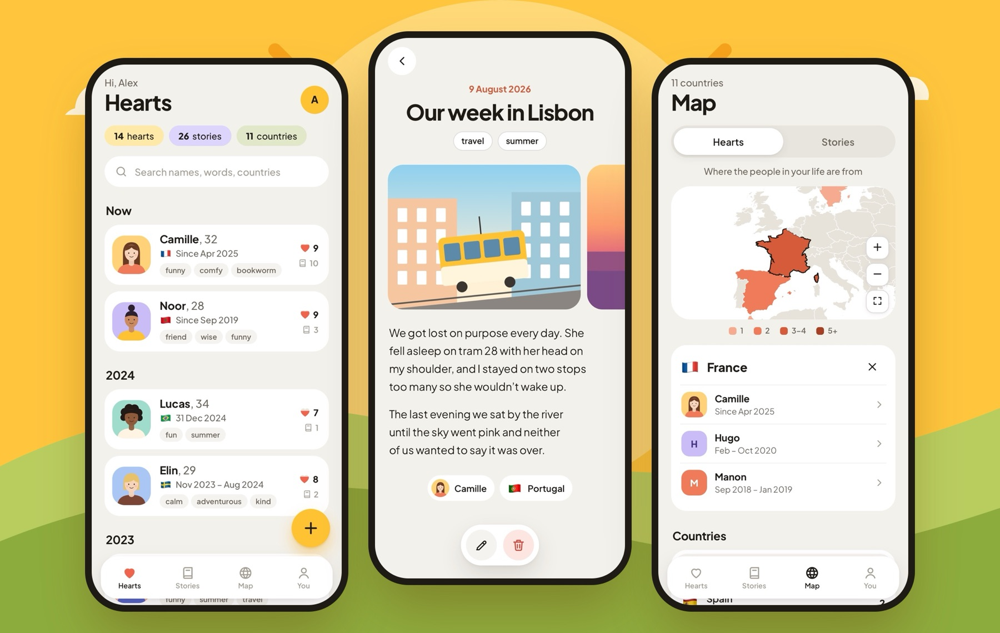

# Little Stories

**The people who shaped your life, and the moments you lived together.** 
A private journal for the loves, crushes and friends you never want to forget.

**[Open Little Stories →](https://littlestories.app.roberrini.com)**

Free to use · Works on any phone · Nothing to install

---

You remember the big moments. It's the small ones that slip away: the name of that café, the joke on the ferry, how old you both were, the way the evening ended.

Little Stories is a quiet place to keep them. Add the people who've been part of your life, write down what you lived together, and watch it all become your own map of memories.

## Everyone who mattered, in one place

Your **Hearts** are the people you want to remember, most recent first. A great love, a summer, a two-week romance, a best friend: everyone gets a page of their own, with their photo, the time you shared, every story you lived together and every picture from those stories.

Paste your song, a video or any link into **Shared things**, and it appears with its cover and title. YouTube and Spotify links work straight away.

The app never says "ex". It's a journal of people, whatever they became to you.

  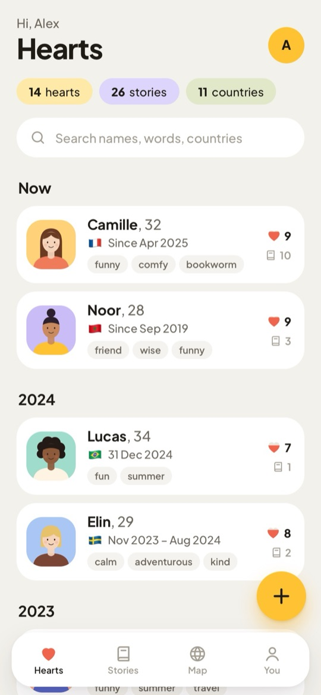
  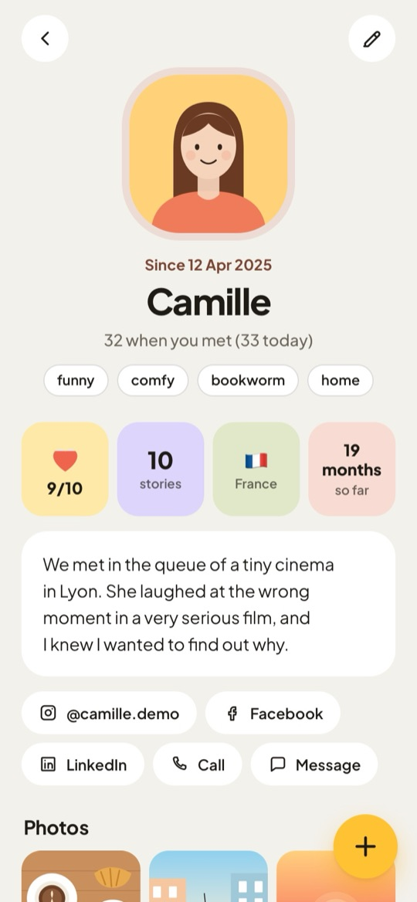
  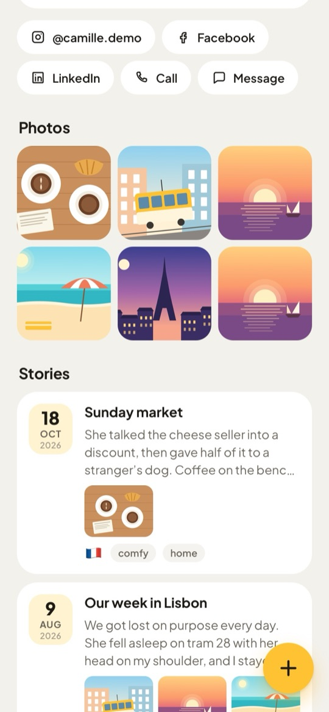

## Add someone in a minute

You don't need the details to get started. Only a name is required, and you can fill in the rest whenever you like.

- **When:** one unforgettable day, a while, or still going. Came back to each other? Add another time.
- **Age:** a rough age is enough. It reads "32 when you met (33 today)", and an exact birthday is optional.
- **One heart that fills:** how much they meant to you, from 1 to 10.
- **In a few words:** tap the words you've used before, pick from ideas like *comfy* or *chaotic*, or write your own.
- **Stay in touch:** Instagram, Facebook, LinkedIn and phone, one tap away.

  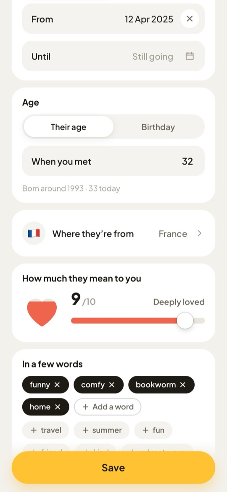
  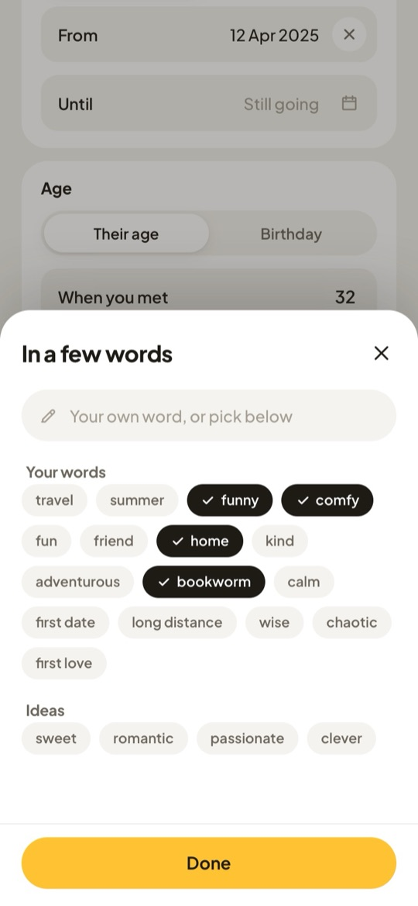

## Write it down before it fades

**Stories** are simple notes: what happened, when, where and who was there. Add photos if you have them. A story can belong to one person, to several, or just to you.

Your timeline runs month by month, with a little calendar on top to jump straight to any month of any year. Search finds a memory by a person, a place or a word.

  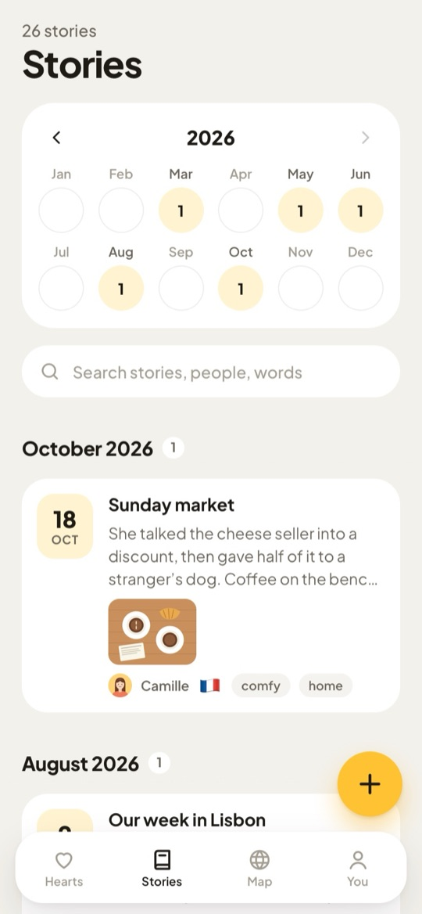
  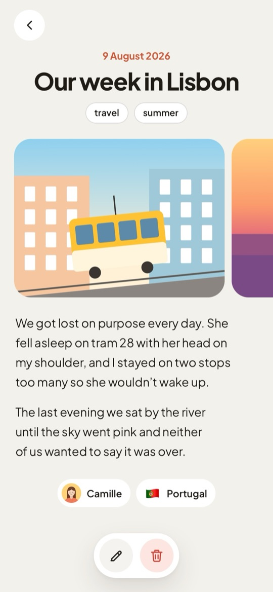
  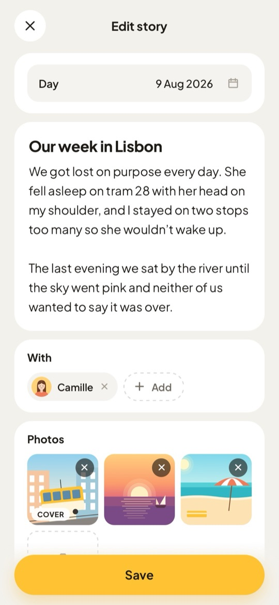

## See your life on a map

Every country lights up as you fill your journal, deeper in colour the more it holds. Switch between where your people are from and where your stories happened, pinch to zoom, and tap a country to see who and what is there.

  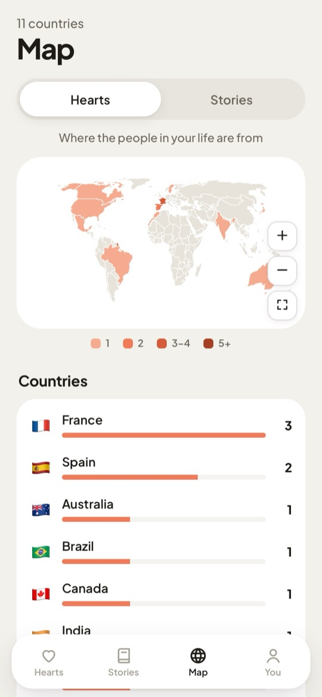
  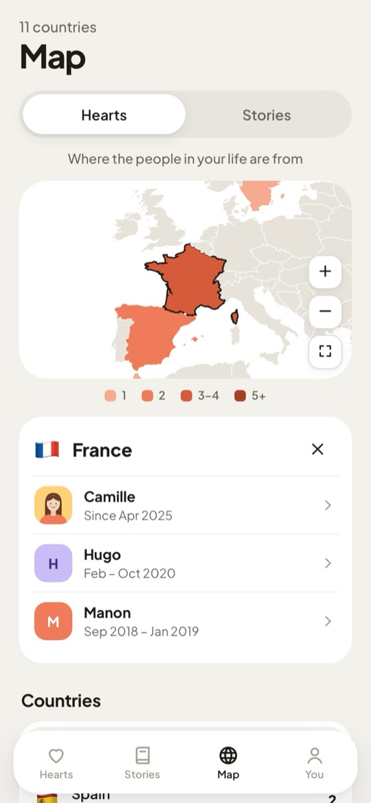
  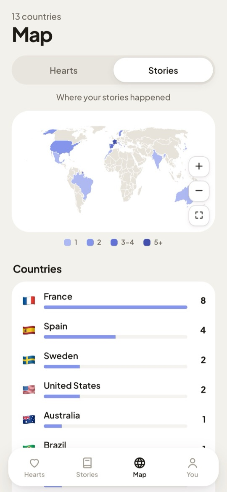

## Your life, in little numbers

**You** is where it all comes together: a few words about yourself, and your journal at a glance. How many people, stories, countries and photos. The words you use most. Your busiest years. Your longest story, and the person you've shared the most with.

  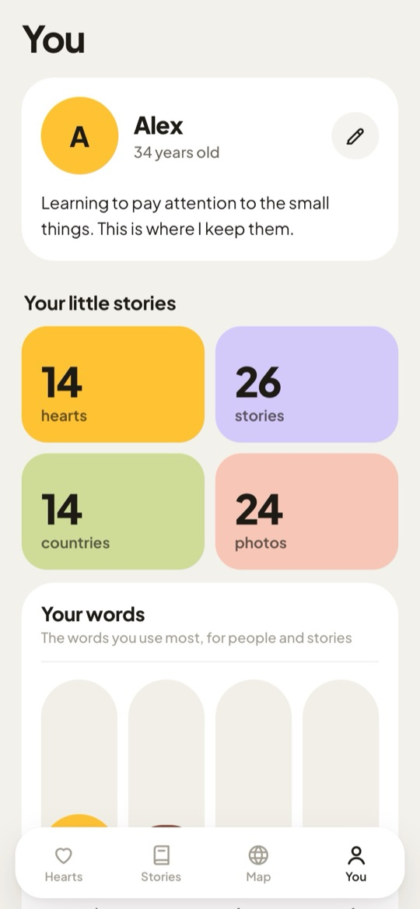
  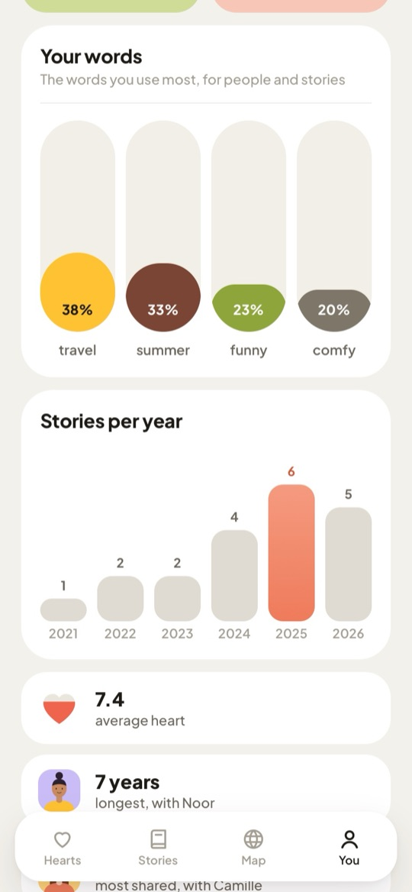

## Private by design

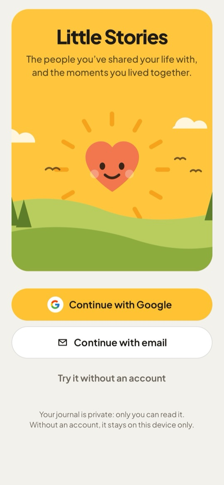

This is a journal, not a social network. There's no feed, no followers and no sharing.

- **Your account, your journal.** Sign in with Google or your email, and your journal stays in sync across your devices. The database only lets each account read and write its own entries, and photos sit in private storage.
- **Or no account at all.** Try it without signing in and everything stays on your device. If you sign in later, you can move it into your account with one tap.
- **Yours to take with you.** Download everything you've written at any time.
- **Works without signal.** Keep writing offline. Your changes are saved as soon as you're back online.

 

## Install it like an app

Little Stories runs in your browser and installs on your phone's home screen:

- **iPhone (Safari):** tap **Share**, then **Add to Home Screen**.
- **Android (Chrome):** open the app, tap ⋮, then **Add to Home screen** or **Install app**.

It opens full screen, like any other app.

**[Start your journal →](https://littlestories.app.roberrini.com)**

---

Everyone in these screenshots is made up, and the pictures are illustrations.

## License

[MIT](LICENSE): use, change and share the code however you like. The font (Plus Jakarta Sans) keeps its SIL Open Font License, and the map data is Natural Earth (public domain) via `world-atlas`.

## For developers

Built with Vite, React and TypeScript, with Supabase for sign-in, storage and photos, and deployed on Vercel. Setup, architecture, deployment and the Android plan are in **[docs/DEVELOPMENT.md](docs/DEVELOPMENT.md)**.
